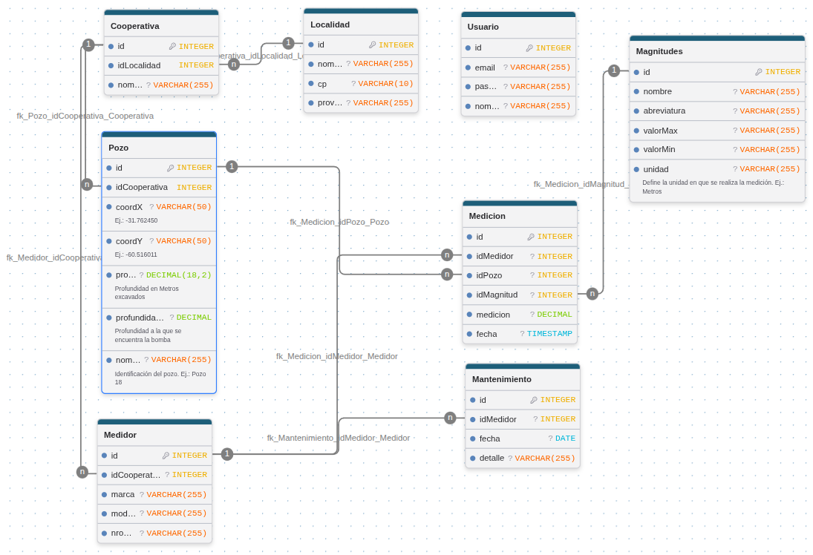

# Base de Datos

La base de datos se encuentra diseñada en SQL para PostgreSQL.

## Diagrama

Se generó un diagrama Entidad-Relación con la herramienta DrawDB para facilitar su comprensión.

## Script SQL

Script de creación de tablas.

CREATE TABLE IF NOT EXISTS "Cooperativa" (
	"id" INTEGER NOT NULL GENERATED BY DEFAULT AS IDENTITY,
	"idLocalidad" INTEGER NOT NULL,
	"nombre" VARCHAR(255),
	PRIMARY KEY("id")
);

CREATE TABLE IF NOT EXISTS "Pozo" (
	"id" INTEGER NOT NULL GENERATED BY DEFAULT AS IDENTITY,
	"idCooperativa" INTEGER NOT NULL,
	-- Ej.: -31.762450
	"coordX" VARCHAR(50),
	-- Ej.: -60.516011
	"coordY" VARCHAR(50),
	-- Profundidad en Metros excavados
	"profundidadPozo" DECIMAL(18,2),
	-- Profundidad a la que se encuentra la bomba
	"profundidadBomba" DECIMAL,
	-- Identificación del pozo. Ej.: Pozo 18
	"nombre" VARCHAR(255),
	PRIMARY KEY("id")
);

COMMENT ON COLUMN "Pozo"."coordX" IS 'Ej.: -31.762450';
COMMENT ON COLUMN "Pozo"."coordY" IS 'Ej.: -60.516011';
COMMENT ON COLUMN "Pozo"."profundidadPozo" IS 'Profundidad en Metros excavados';
COMMENT ON COLUMN "Pozo"."profundidadBomba" IS 'Profundidad a la que se encuentra la bomba';
COMMENT ON COLUMN "Pozo"."nombre" IS 'Identificación del pozo. Ej.: Pozo 18';

CREATE TABLE IF NOT EXISTS "Medidor" (
	"id" INTEGER NOT NULL GENERATED BY DEFAULT AS IDENTITY,
	"idCooperativa" INTEGER,
	"marca" VARCHAR(255),
	"modelo" VARCHAR(255),
	"nroSerie" VARCHAR(255),
	PRIMARY KEY("id")
);

CREATE TABLE IF NOT EXISTS "Mantenimiento" (
	"id" INTEGER NOT NULL GENERATED BY DEFAULT AS IDENTITY,
	"idMedidor" INTEGER,
	"fecha" DATE,
	"detalle" VARCHAR(255),
	PRIMARY KEY("id")
);

CREATE TABLE IF NOT EXISTS "Localidad" (
	"id" INTEGER NOT NULL GENERATED BY DEFAULT AS IDENTITY,
	"nombre" VARCHAR(255),
	"cp" VARCHAR(10),
	"provincia" VARCHAR(255),
	PRIMARY KEY("id")
);

CREATE TABLE IF NOT EXISTS "Usuario" (
	"id" INTEGER NOT NULL GENERATED BY DEFAULT AS IDENTITY,
	"email" VARCHAR(255),
	"password_hash" VARCHAR(255),
	"nombre" VARCHAR(255),
	PRIMARY KEY("id")
);

CREATE TABLE IF NOT EXISTS "Medicion" (
	"id" INTEGER NOT NULL GENERATED BY DEFAULT AS IDENTITY,
	"idMedidor" INTEGER,
	"idPozo" INTEGER,
	"idMagnitud" INTEGER,
	"medicion" DECIMAL,
	"fecha" TIMESTAMP,
	PRIMARY KEY("id")
);

CREATE TABLE IF NOT EXISTS "Magnitudes" (
	"id" INTEGER NOT NULL GENERATED BY DEFAULT AS IDENTITY,
	"nombre" VARCHAR(255),
	"abreviatura" VARCHAR(255),
	"valorMax" VARCHAR(255),
	"valorMin" VARCHAR(255),
	-- Define la unidad en que se realiza la medición. Ej.: Metros
	"unidad" VARCHAR(255),
	-- Representa el valor óptimo.
	"valorOptimo" VARCHAR(255),
	PRIMARY KEY("id")
);

COMMENT ON COLUMN "Magnitudes"."unidad" IS 'Define la unidad en que se realiza la medición. Ej.: Metros';
COMMENT ON COLUMN "Magnitudes"."valorOptimo" IS 'Representa el valor óptimo.';

ALTER TABLE "Pozo"
ADD FOREIGN KEY("idCooperativa") REFERENCES "Cooperativa"("id")
ON UPDATE NO ACTION ON DELETE NO ACTION;
ALTER TABLE "Cooperativa"
ADD FOREIGN KEY("idLocalidad") REFERENCES "Localidad"("id")
ON UPDATE NO ACTION ON DELETE NO ACTION;
ALTER TABLE "Medicion"
ADD FOREIGN KEY("idMedidor") REFERENCES "Medidor"("id")
ON UPDATE NO ACTION ON DELETE NO ACTION;
ALTER TABLE "Mantenimiento"
ADD FOREIGN KEY("idMedidor") REFERENCES "Medidor"("id")
ON UPDATE NO ACTION ON DELETE NO ACTION;
ALTER TABLE "Medicion"
ADD FOREIGN KEY("idPozo") REFERENCES "Pozo"("id")
ON UPDATE NO ACTION ON DELETE NO ACTION;
ALTER TABLE "Medidor"
ADD FOREIGN KEY("idCooperativa") REFERENCES "Cooperativa"("id")
ON UPDATE NO ACTION ON DELETE NO ACTION;
ALTER TABLE "Medicion"
ADD FOREIGN KEY("idMagnitud") REFERENCES "Magnitudes"("id")
ON UPDATE NO ACTION ON DELETE NO ACTION;